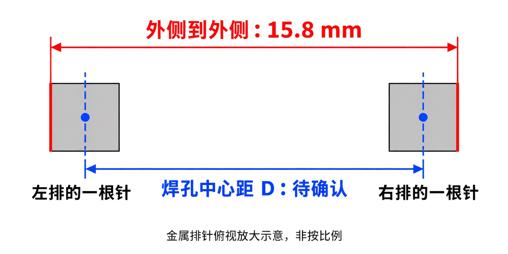

# 双通道数字电压表：最新设计报告

设计版本：**V2.3受控原理图草案**。文档更新：2026-10-23（America/New_York）。

本报告完整描述当前电路、参数、接口与计算依据。每次设计更新后重写本文，保持一个现行版本；问题、处理历史与验证结果统一记录在[当前进度](progress.md)。项目功能与验收来源见[项目最初目标](project-goals.md)。

## 1. 设计范围与工程文件

主控目标已确认为 **STM32F103C8T6 Blue Pill**，采用核心板公排针插入底板两条直插排母的安装方式。现有V2.3原理图仍是模块逻辑接口草案，术语 M1 的 1～17 不是实体排母孔号；Blue Pill 的板级差异、两排中心距和板载 SWD 对接仍待实板核对。本次调查不修改工程。

系统由STM32控制ADC0832，顺序采集两路共地0～5V直流输入。前端分别分压、钳位、缓冲和滤波；独立USB与外部5V经选源电路供电；STM32辅助ADC测量基准和VANA，用于参考补偿。UART连接上位机，J7预留OLED接口。

当前为连接草案：64个电路图符、3个手动供电声明、47个命名网络、183个已接电路引脚、5个NC。**64项已全部分配封装；M1模块封装按开源资料建立，克隆板公差待实测**。PCB及采购BOM尚未定稿。进入制造前的关闭条件见[进度问题表](progress.md#3-问题与关闭条件)。

| 材料 | 位置与用途 |
| --- | --- |
| KiCad工程 | [voltmeter-v2.3-draft.kicad_pro](../hardware/v2.3/voltmeter-v2.3-draft.kicad_pro) |
| 原理图 | [voltmeter-v2.3-draft.kicad_sch](../hardware/v2.3/voltmeter-v2.3-draft.kicad_sch) |
| 审阅PDF | [voltmeter-v2.3-draft.pdf](../hardware/v2.3/review/voltmeter-v2.3-draft.pdf)，A1单页，放大阅读 |
| 连接蓝图 | [connections-draft.json](../hardware/v2.3/connections-draft.json)，包括电路元件及供电声明 |
| 局部图符库 | [V23Draft.kicad_sym](../hardware/v2.3/V23Draft.kicad_sym)及[sym-lib-table](../hardware/v2.3/sym-lib-table) |
| 项目封装库 | [V23Draft.pretty](../hardware/v2.3/V23Draft.pretty/)及[fp-lib-table](../hardware/v2.3/fp-lib-table) |
| 引脚数据 | [pin-connections.csv](pin-connections.csv)，188条电路引脚记录，包括183个接线及5个NC |

同名标签在单页内电气相连，完整网络端点见附录。M1编号1～17是逻辑端点，实体Blue Pill排针映射须依据实板建立；Q1/Q2使用G/S/D和B/C/E功能引脚。D1～D4为独立两脚低漏电二极管，已选用BAS116H,115（SOD-123F），1=K、2=A与现有符号一致。

## 2. 总体结构

```text
独立USB-B 5V → F1 ─────────────────┐
                                    ├→ U5 TPS2115A → SYS_5V → Blue Pill → 3V3
外部5V → F2 → Q1 PMOS反接保护 ─────┘                 │
                                                      └→ R4 1Ω → VANA

J3 CH0 → 180k/1.2M分压＋上下钳位 → U2A跟随 → 220Ω/100nF → U1 CH0
J4 CH1 → 180k/1.2M分压＋上下钳位 → U2B跟随 → 220Ω/100nF → U1 CH1

STM32 PB0/PB1/PB10 → U3 AHCT三路 → U1 CS/CLK/DI
U1 DO → U4 LVC（3V3供电）→ STM32 PB11
STM32 PB12 → Q2 NPN → U3 OE

3V3 → 68Ω → U6 TL431基准 → 1kΩ → PA1
VANA → 10k/10k分压 → 1kΩ → PA0
UART：J6；SWD：J5；OLED预留：J7；所有电路共地
```

## 3. 主要器件与供电域

| 位号 | 现行器件/功能 | 供电及候选实体 |
| --- | --- | --- |
| U1 | ADC0832CCN双通道8位ADC | VANA；ADC0832CCN/NOPB、PDIP-8封装已分配（TI该料号已停产，用户确认可采购） |
| U2 | MCP6002双路跟随器 | VANA；MCP6002-I/P、DIP-8封装已分配 |
| U3 | 74AHCT125三路正向数字缓冲 | VANA；SN74AHCT125N、TI N14专用DIP-14封装已分配 |
| U4 | 74LVC1G125反向电平转换 | 3V3；SN74LVC1G125DBVR、SOT-23-5手焊封装已分配 |
| U5 | TPS2115A双源MUX | IN1/IN2输入；TPS2115APW、TSSOP-8封装已分配 |
| U6 | TL431BCLP辅助基准 | 3V3经68Ω供电；TI LP/TO-92专用P1.27mm/φ0.85mm封装已分配 |
| M1 | STM32F103C8T6 BluePill 模块 | 两条1×20排母、P2.54、排距15.24mm；PA13/PA14需独立SWD；克隆板公差待实测 |
| Q1 | 外部电源反接PMOS | AO3401A、SOT-23；项目封装焊盘G/S/D对应原厂1/2/3 |
| Q2 | OE控制NPN | 2N3904BU、TO-92直插；项目封装焊盘E/B/C对应原厂1/2/3 |
| D1～D4 | 高阻模拟节点上下钳位 | Nexperia BAS116H,115，SOD-123F单只低漏电二极管；1=K、2=A与现有两脚符号一致 |
| F1/F2 | USB/外部源保险丝 | Littelfuse 37011000000，TR5 Ø8.5×8mm、P5.08mm、1A/250V快断 |

AHCT接收3.3V逻辑的依据须对应准确型号；74HC125不直接等同AHCT。U4接收5V侧DO并输出3.3V逻辑。Ioff与正常工作范围按实际器件条件核对。

## 4. 电源选择、反接与去耦

### 4.1 功能连接

- J1.1 VBUS经F1到USB_SAFE；J1.4接GND。J1.2/3（D−/D+）NC，USB仅用于合适5V适配器供电。屏蔽壳经R6=0Ω接GND。
- J2.1经F2到EXT_FUSED，Q1 D接EXT_FUSED、S接EXT_SAFE，G经R1=100kΩ接GND；J2.2接GND。单只PMOS导通后可双向流动，源间保护依靠MUX及全路径设计。
- U5 OUT为SYS_5V，供M1.1；SYS_5V经R4=1Ω/1%到VANA。VANA供U1/U2/U3，并经R5=4.7kΩ/1%泄放到GND。
- C1/C2各100nF接USB_SAFE/EXT_SAFE；C3/C4各10µF候选接SYS_5V/VANA；C5=100nF接VANA。C6/C7/C8分别为U2/U1/U3的100nF去耦，C9为U4的3V3去耦。

10µF器件当前仅为功能电容，介质、ESR、极性和封装需随准确物料确定。输入储能、启动浪涌与热插拔联合预算。

### 4.2 TPS2115A连接

| U5脚 | 功能 | 当前连接 |
| --- | --- | --- |
| 1 | STAT | NC |
| 2 | D0 | 不外接，采用内部上拉的自动模式候选 |
| 3 | D1 | GND |
| 4 | ILIM | R2=680Ω与R3=20Ω串联至GND，均1% |
| 5 | GND | GND |
| 6 | IN2 | EXT_SAFE |
| 7 | OUT | SYS_5V |
| 8 | IN1 | USB_SAFE |

自动模式按输入比较器选择电压较高源，近等压受约0.1～0.2V迟滞和10～50µs去毛刺时间影响。700Ω手册测试点的限流典型约0.71A、范围约0.47～0.99A；这不是270mA负载的精确限流设定。实际电阻容差、源能力和保险丝须共同核算。

三项手动供电声明为：#FLG001=USB_SAFE（J1→F1）、#FLG002=EXT_SAFE（J2→F2→Q1）、#FLG003=VANA（U5 OUT→SYS_5V→R4）。标记只声明正常来源，独立列在蓝图`power_declarations`中，不计入64个电路图符及188条引脚CSV。

### 4.3 现行条件预算

| 项目 | 预算值与条件 |
| --- | --- |
| 本板入口电压 | 4.75～5.25V，测在接口，仍需适配器/线缆验证 |
| 全板峰值分配 | 270mA，包含核心板、显示预留、基准及余量 |
| VANA支路分配 | 22mA；TL431由3V3供电，不计入这条支路 |
| 输入保护路径电阻 | ≤0.25Ω，包含保险丝、连接器、Q1所在路径和走线，需热态核验 |
| MUX导通电阻 | 0.15Ω预算，其手册温度/电压测试条件需适用于实际器件 |
| 模拟串联电阻最坏值 | R4=1.01Ω |

```text
SYS_min  = 4.75 − 0.270 × (0.25 + 0.15) = 4.642V
VANA_min = 4.642 − 0.022 × 1.01 = 4.61978V
```

以上为[条件预算脚本](../scripts/v2_2_budget.py)的分配值。轻载上限仍可能接近5.25V；纹波、瞬态、故障功耗和LDO温升需单独验证。核心板3V3负载包含TL431最大约16.83mA供电电流。

## 5. 双路模拟前端与输入保护

### 5.1 当前阻容与反馈

| 功能 | CH0 | CH1 | 数值/连接 |
| --- | --- | --- | --- |
| 输入 | J3.1 | J4.1 | 信号；接口2脚接GND |
| 串联限流/分压 | R10 | R14 | 180kΩ/1%，输入→SENSE |
| 下拉分压 | R11 | R15 | 1.2MΩ/1%，SENSE→GND |
| 下钳位 | D1 | D3 | 阳极GND，阴极SENSE |
| 上钳位 | D2 | D4 | 阳极SENSE，阴极VANA |
| 跟随器输入 | U2.3 | U2.5 | 分别接SENSE_CH0/SENSE_CH1 |
| 本路直接反馈 | U2.1→2 | U2.7→6 | 反馈取运放输出，位于隔离电阻之前 |
| ADC串联隔离 | R12 | R16 | 220Ω，BUF→ADC_CH |
| ADC端电容 | C10 | C11 | 100nF，ADC_CH→GND |

U2.4接GND、U2.8接VANA。默认没有向SENSE接10MΩ偏置；该候选仅文字预留，未计入当前网表。

### 5.2 静态与建立预算

无偏置时，名义`α = 1.2M / (180k + 1.2M) ≈ 0.869565`，`V_SENSE = α × Vin`。0～5V理想映射到0～4.347826V。

- 输入电阻名义1.38MΩ；仅计1%电阻角点的最小值为1.3662MΩ。实际端口负载还包含漏电与源阻抗效应。
- 高阻节点戴维南电阻约156.522kΩ。输入折算漏电敏感度约`180kΩ × I_net`：30nA对应约5.4mV，100nA约18mV。
- 5V输入、1%最坏比例角点为4.359085V；与条件VANA_min之间理想余量约260.695mV。
- VANA=5V时输入折算步长约22.461mV/LSB；VANA=5.25V时约23.584mV/LSB。
- 220Ω/100nF名义时间常数22µs、单极点截止约7.23kHz；全幅阶跃到8位半LSB的理想建立约137.25µs。

零输入处运放的摆幅/失调、保护漏电及动态负载由实际器件确定。RC用于输出隔离与高频抑制，抗混叠还取决于输入频带、原始采样率及平均方式。

### 5.3 断电输入模型

断电而输入存在时，候选路径为输入→180kΩ→上钳位→VANA→R5→GND。外部硅二极管与芯片内部保护的导通先后、钳位压差和允许电流须按实际器件验证；MCP6002内部正向保护结构按Microchip第4.1.2节处理。

仅对实际导通的输入求和；忽略二极管压降、1.2MΩ及芯片负载，得到保守DC估算：

`VANA_off ≤ Σ(Vin_i / Rs_i) / (1/Rbleed + Σ(1/Rs_i))`

| 输入工况 | 180kΩ与4.7kΩ各1%角点上界 |
| --- | --- |
| 两路0V | 0V |
| 单路5V，另一路0V | 0.129737V |
| 两路5V | 0.252912V |

前提是仅有这两个≤5V的输入注入，电容已充分放电，其他电源/信号路径无额外注入。单路限流粗上界约28.1µA，两路≤56.2µA；这些估算仅覆盖VANA的该DC模型。R5正常在5.25V及−1%阻值下约1.128mA、5.92mW。

Diodes BAV199资料为DS30232 Rev11-2（2022-11），串联双管结构可构成GND→SENSE→VANA链路。每管漏电5nA@25°C、80nA@150°C均对应VR=75V及手册脚注条件；双管敏感度分别约1.8mV和28.8mV。0～70°C整板漏电不能由这两个测试点插值保证。其VF≤0.90V限于IF=1mA、25°C条件。实体双管脚序和当前独立D图符的映射归P0-I/P0-M。

## 6. 数字接口、使能与逻辑资源

### 6.1 ADC0832与缓冲连接

| U1脚 | 功能 | 当前连接 |
| --- | --- | --- |
| 1 | CS | ADC_CS_N，经R23=100Ω接U3.3；R26=10kΩ上拉VANA |
| 2 | CH0 | ADC_CH0 |
| 3 | CH1 | ADC_CH1 |
| 4 | GND | GND |
| 5 | DI | ADC_DI，经R25=100Ω接U3.8；R28=47kΩ下拉 |
| 6 | DO | ADC_DO_5V→U4.2；R29=47kΩ下拉 |
| 7 | CLK | ADC_CLK，经R24=100Ω接U3.6；R27=47kΩ下拉 |
| 8 | VCC | VANA |

ADC0832参考内部绑定VCC，U6通过STM32辅助监测参与换算。两路为内部复用、依次转换；DI/DO保持独立。时钟和采样协议以准确采购型号手册为准。

U3三条通路为2→3（CS）、5→6（CLK）、9→8（DI）。三个A输入分别经R20/R21/R22=47kΩ下拉；U3.1/4/10并入BUF_OE_N。U3.7=GND、14=VANA；第四路12脚接GND、13脚接VANA禁用、11脚NC。

BUF_OE_N经R33=10kΩ上拉VANA，Q2 C接该网、E接GND。PB12经R31=10kΩ到Q2 B，B经R32=100kΩ下拉。PB12高电平使能，复位高阻时禁用；电源与GPIO准备好后再使能。上拉电流约0.53mA（5.25V条件），基极驱动分配约0.20mA（3.0V、VBE=0.9V及容差条件），准确NPN仍须核验。

U4.1低有效OE直接接GND，2脚输入ADC_DO_5V，3脚GND，4脚经R30=100Ω到MCU_DO，5脚接3V3。NPN控制OE只解决使能电压域；AHCT A输入和LVC端口在部分上电时的路径见P0-P。

### 6.2 M1逻辑编号

| M1逻辑编号 | MCU/模块功能 | 当前网络 |
| --- | --- | --- |
| 1 | 模块5V输入 | SYS_5V |
| 2 | 模块3V3电源域 | 3V3 |
| 3 | 公共地 | GND |
| 4 | PB0 / CS | MCU_CS |
| 5 | PB1 / CLK | MCU_CLK |
| 6 | PB10 / DI | MCU_DI |
| 7 | PB11 / DO | MCU_DO |
| 8 | PB12 / 高有效使能 | MCU_BUF_ENABLE_H |
| 9 | PA0 / VANA监测 | MON_VANA |
| 10 | PA1 / 基准监测 | MON_REF |
| 11 | PA9 / UART TX | UART_TX |
| 12 | PA10 / UART RX | UART_RX |
| 13 | PA13 / SWDIO | SWDIO |
| 14 | PA14 / SWCLK | SWCLK |
| 15 | 复位 | NRST |
| 16 | PB6 / I²C SCL | I2C_SCL |
| 17 | PB7 / I²C SDA | I2C_SDA |

### 6.3 外部接口

| 接口 | 当前针序 |
| --- | --- |
| J3/J4模拟输入 | 1=SIG，2=GND；面板BNC通过短同轴线转接 |
| J5 SWD | 1=3V3电压感知、2=GND、3=SWDIO、4=SWCLK、5=NRST；核对调试器1脚是感知而非电源输出 |
| J6 TTL | 1=UART_TX、2=UART_RX、3=GND；3.3V逻辑，与对端TX/RX交叉 |
| J7 OLED预留 | 1=3V3、2=GND、3=SCL、4=SDA；模块针序和自带上拉须核对 |

### 6.4 核心板排母与机械参数记录

**正式规格登记：[STM32F103C8T6 Blue Pill 模块规格（M1）](reviews/2026-10-23-stm32f103c8t6-module-spec.md)**：芯片参数、两排中心距 15.24mm、48.26mm 首末、Ø1.016mm 孔、17 脚映射、供电与 SWD 约束及待实测项。

本轮[元器件与真实封装专项审查](reviews/2026-10-23-component-package-audit/README.md)保存64个位号审查表、F103/Blue Pill 管脚对应及原始检查证据；完整的[Blue Pill板级信息复核](reviews/2026-10-23-stm32f103-blue-pill-investigation.md)单独记录标准布局、供电风险和装配限制。

记录日期：2026-10-23（America/New_York）。用户已确认主控为 **STM32F103C8T6 Blue Pill**，通过核心板下方公排针插入底板两条焊接排母。**具体克隆板品牌/板号、LDO、USB接口、实际针宽、两排中心距D和实体针序尚未确认。**

排母候选为 **Harwin M20-7822046**，以下为该候选的原厂参数；记录参数不等于已确认它与当前核心板实物匹配，也不冻结模块或排母封装。

| 项目 | 记录值 | 依据与状态 |
| --- | --- | --- |
| 候选排母规格 | 单排20位，左右各一条 | 排母规格已核；核心板是否每排20针待确认 |
| 排母同排针距 | 2.54mm | 原厂参数；核心板同排针距待核 |
| 标准Blue Pill排布 | 2×20针，P2.54mm；板外形约53×23mm | 第三方板级资料名义值；与标准装配插座一致，不是本块实板受控尺寸 |
| 名义两排中心距 | 约15.24mm（0.6in） | 标准Blue Pill装配惯例；本次仍以实板针宽/中心距确认，不直接写死 |
| 首末针中心跨度 | 48.26mm | 仅在每排20针且针距2.54mm时，按`(20−1)×2.54`计算的名义值 |
| 用户实测排间外跨 | **1.58cm＝15.8mm，用户已确认** | 用户用千分尺测量，并对照下图确认端点为左排排针金属左外表面与右排排针金属右外表面 |
| 两排中心距 | **D，待确认** | `D=15.8−(w左+w右)/2`，单位mm；测量端点已确认，待取得左右实际针宽后计算中心距 |
| 排母塑胶外形 | 标称长51.20mm、宽2.50mm | 原厂参数；公差及装配包络以原厂图为准 |
| 排母板上高度 | 标称8.50mm | 不直接作为两块PCB之间的最终叠高 |
| 排母焊尾长度 | 标称3.00mm | 核对底板厚度及焊接空间 |
| 配对公针 | 0.64mm方针 | 原厂适配规格；现有公针截面和有效插入长度待核 |
| 推荐PCB孔径 | φ1.02±0.05mm | 原厂推荐；后续须核对板厂成品孔公差 |
| 本机通用库对照 | `Connector_PinSocket_2.54mm:PinSocket_1x20_P2.54mm_Vertical` | 已读取20孔、2.54mm针距、48.26mm首末跨度、1.70×1.70mm焊盘、φ1.00mm孔径；尚未核准为该排母的专用封装 |



图：用户已确认测量位置。红色15.8mm标注连接左右排针的金属外表面，蓝色D标注连接两排排针中心。此图由生图模型生成，用于说明测量端点，非等比例图，不作为钻孔模板。

排母塑胶外宽、核心板PCB宽度、排针外侧跨距和两排焊孔中心距是不同尺寸。`w左`、`w右`为左右排针沿跨排方向的实际宽度，尚未测定；候选排母适配0.64mm方针不等于现有公针实测宽度。若两针均为0.64mm，则15.8mm外跨对应中心距15.16mm；标准布局名义15.24mm对应理论外跨15.88mm，两者仅差0.08mm，支持标准Blue Pill外形但不足以冻结本块实板。量同排针距时，先数针数N，再量首末针中心跨度并除以`N−1`；两排应量中心距，不能用塑胶外缘距离直接代替。实体孔号必须固定核心板正面及USB端方向，再建立GPIO→左右排针→排母焊孔对应表，不能把M1的1～17逻辑编号直接当作插座孔号。

**装配限制：** Blue Pill 的 PA13/SWDIO、PA14/SWCLK 不在两条 20 针排上，只在独立 4 针 SWD 排针；底板 J5 的 SWDIO/SWCLK 不能仅靠两条排母传递，必须另设排针对接或线缆。Blue Pill 的 5V 针与 USB VBUS、LDO 输入直连，参考板无反向保护；由底板 5V 供电时必须禁止板载 USB 和外部电源同时接入。

最终封装还须核对模块外形、USB伸出、按键/跳帽及底部元件限高、公针有效插入长度、排母塑胶包络和装配余量。尺寸确认后先用1:1孔位图与实物试插，再批准工程封装。芯片型号本身不能确定核心板的这些机械尺寸。

资料来源：[Harwin M20-7822046原厂产品页](https://www.harwin.com/products/M20-7822046)、[M20-782原厂工程图（Rev 11，2026-08-03）](https://content.harwin.com/asset/53851ba8-b32e-4ac5-a0c5-09d9271c0c0a/DRG-00385-Technical-Drawing-Datasheet-M20-782-pdf.pdf)、[STM32F103C8官方页面](https://www.st.com/en/microcontrollers-microprocessors/stm32f103c8.html)、[Blue Pill原始参考图](https://stm32-base.org/assets/pdf/boards/original-schematic-STM32F103C8T6-Blue_Pill.pdf)。F103 ADC条件以ST DS5319 Rev20表47/49为准；56MHz PCLK2、14MHz ADC是原厂精度试验条件，实际固件时钟仍需核对。

### 6.5 封装与MPN实施状态

本阶段在独立开发分支为64个位号写入可解析的KiCad封装、MPN和厂家属性，并建立5个项目专用封装。U1按用户确认选用TI ADC0832CCN/NOPB（PDIP-8，TI P(R-PDIP-T8) 4040082/E核对，封装DIP-8_W7.62mm）；注意TI官方该料号为Obsolete，采购须核批次真伪。F1/F2改用Littelfuse 37011000000（TR5，Ø8.5×8mm，P5.08mm，1A/250V快断，KiCad `Fuse_Littelfuse_372_D8.50mm`）。M1建立 `V23Draft:BluePill_STM32F103C8T6_Module`：两条1×20、P2.54、排距15.24mm（开源BluePill封装与15.8mm外跨−0.56mm针宽互相印证）、首末48.26mm、孔1.016mm。D1～D4选用Nexperia BAS116H,115（SOD-123F）：25°C漏电5nA、150°C 80nA、VR75V、IF215mA、Ptot375mW，1=K/2=A与现有两脚符号及保护拓扑一致，不需要改网络。完整清单、原厂尺寸依据、采购链接和验证原始记录见[V2.3真实元器件与封装开发记录](reviews/2026-10-23-v2.3-footprint-development/README.md)。

封装分配不改变任何网络：原网表仍为64元件、47命名网、183接线、5NC和3供电声明。ERC和焊盘编号检查已通过，但这只表示结构一致，不能作为PCB或整机验收。

器件与封装层面已无阻塞项：U1=ADC0832CCN/NOPB（DIP-8）、F1/F2=37011000000（TR5, P5.08）、M1=BluePill 2×1×20 排母（排距15.24mm）。但仍不具备PCB设计准入：M1 克隆板实际公差未实测，且尚未做 PCB DRC 与装配检查。

## 7. 基准、VANA监测与解算

### 7.1 参考电路

```text
3V3 → R40 68Ω/1% → REF_2V495 → U6.1 K
                              └→ U6.3 REF
GND ───────────────────────────→ U6.2 A
REF_2V495 → R41 1kΩ/1% → MON_REF → PA1
VANA → R42 10kΩ/1% → VANA_HALF → R43 10kΩ/1% → GND
VANA_HALF → R44 1kΩ/1% → MON_VANA → PA0
```

TI TL431BCLP的LP脚序按SLVS543S第4页图及表5-1：1=K、2=A、3=REF，K与REF短接。当前K、PA0、PA1均无额外并联采样电容。

第6.11节的25°C/10mA参考范围为2483～2507mV，全温偏移16mV、最小调节电流最大0.6mA。预算采用2.495±(0.012+0.016)V包络；3V3为3.0～3.6V、R40为1%时，供电电流约6.945～16.830mA，R40最大功耗19.1mW。电流变化另列4mV参考误差分配，尚需按实际条件验证。

本地TL431手册第9.2.2.2.3节及SLVA482A指出容性负载需检查稳定区；B型、VKA=VREF对应第18页图6-18/19的B组A曲线。当前不直接增加阴极电容，1kΩ隔离后的ADC动态负载、寄生及测量探头仍纳入稳定性检查。

### 7.2 辅助ADC条件预算

| 项目 | 当前计算基线 |
| --- | --- |
| 监测分压名义/1%角点 | k=0.5，范围0.495～0.505；5.25V时PA0理想最大2.65125V |
| PA0源阻抗 | 10kΩ并联10kΩ＋1kΩ，名义6kΩ、最大6.060kΩ |
| PA1源阻抗 | 约1kΩ＋TL431动态源阻抗 |
| STM32资料 | 原厂DS5319 Rev20，2025-07；本次核对表5、表47～50。历史本地副本为DocID13587 Rev17第三方镜像 |
| 时钟候选 | 数据手册精度条件为PCLK2=56MHz、ADC=14MHz；Blue Pill名义8MHz HSE下，实际固件可选择56/14或72/12等组合，需按时钟树和ADC分频核对 |
| 采样/总转换 | 239.5/252个ADC周期，17.107µs/18µs |
| 理想1/4个12位LSB建立 | `(6060Ω+1000Ω) × 8pF × ln(2^14) ≈ 0.5481µs` |

Rev17表46给出R_ADC最大1kΩ、C_ADC最大8pF；表48的±2LSB条件含56MHz/14MHz、RAIN<10kΩ、VDDA=3～3.6V、25°C、校准后；表49的±5LSB也受时钟、源阻抗和校准条件限制。当前整板VDDA工作候选为3.0～3.6V。版本适用性、实板VDDA路径及动态检验在P0-R/P0-P中跟踪。

[参考/采样脚本](../scripts/reference_sampling_budget.py)采用每组参考/VANA/参考共6次转换（含切换丢弃样本）、每个20Hz主帧两组的条件模型：理想总转换时间216µs/帧，PA1共160次转换/秒；单次电荷上界20.184pC、绝对平均采样电荷电流约3.229nA。按显式参考引脚与ADC漏电分配、理想采样峰值计算，阴极电流约4.391～17.976mA。该模型未包含TL431环路传递、寄生电容、充电注入和实际固件开销。

### 7.3 解算与校准

```text
VANA ≈ VREF_actual × ADC(PA0) / ADC(PA1) / k_monitor
Vin  ≈ VANA × Code_ADC0832 / (256 × α)
α ≈ 0.869565（当前无偏置前端）
```

使用实际测得基准值、每路零点/增益校准与准确转换曲线。理想公共VDDA项在比值中相消；通道偏差、参考噪声和相邻采样间变化分别计入误差。

监测与ADC0832主帧须关联时间；供电切换时暂停有效测量，待电源、参考、ADC校准与同步恢复后重新输出。具体时限由实际动态测试确定。

## 8. 精度与采样吞吐预算

### 8.1 条件误差分配

| 项目 | 输入折算分配 |
| --- | --- |
| ADC0832 ±1LSB | 23.584mV，准确厂家/等级和条件待核验 |
| 单独半LSB量化项 | 11.792mV，需核对与TUE定义有无保守重叠 |
| MCP6002 ±4.5mV失调 | 5.175mV |
| 净漏电30nA分配 | 5.454mV，尚缺全温整板上界 |
| TL431 16mV温漂项 | 32.064mV |
| TL431电流变化4mV分配 | 8.016mV |
| 辅助ADC比值±5LSB条件分配 | 18.548mV，需对应准确资料与实际配置 |
| 电阻组合温漂0.6%分配 | 30.000mV |
| 条件线性加和 | 134.633mV |

该加和未包括低端削顶、被测源加载、完整漏电、动态建立、监测时差、串扰和污染噪声；分配假设须分别验证。最终精度与环境由REQ-01确认，实验通过条件记录在进度文档。

### 8.2 主采样与平均

五组平均次数候选1、4、8、16、32。最大32次、20完整双通道帧/秒，需要至少`2 × 32 × 20 = 1280`次有效转换/秒。

当前按100kHz CLK、每完整交易最多32时钟分配时隙：320µs/次，1280次占409.6ms/秒。地址、空位、CS间隔、建立等待、丢弃转换、监测和通信开销由准确时序与驱动实测补齐。连续/分组平均方式须与响应实验配套。

软件按同一帧组织两路数值并用于绘图和存储，记录时间、通道偏差、平均次数及无效帧；通信或读回错误需与有效0V区分。当前仓库尚无固件和上位机实现。

## 9. 使用工况与布局约束

采用先烧录调试、断开带电调试器、独立供电测量的流程；掉电主板不长期连接带电SWD、TTL或独立供电OLED，核心板原USB不与测量电源并接。当前未增加硬件总线隔离器件，不要求USB物理遮挡或切断。

| 工况 | 当前需检查的电流路径 |
| --- | --- |
| USB单独 | J1→F1→U5 IN1→OUT→SYS_5V/VANA |
| 外部单独 | J2→F2→Q1 D/S→U5 IN2→OUT |
| 两源近等压/拔插 | 选中源、MUX、输出储能与下降源之间的回流 |
| 板断电、两输入存在 | 输入→串联限流→上钳位→VANA→R5，另查内部保护/输出路径 |
| VANA有电、3V3异常掉电 | VANA→R42/R43/R44→PA0；5.25V及理想0V钳位时角点约442.65µA |
| 3V3有电、VANA异常掉电 | PB0/PB1/PB10→AHCT A端；U4端口与ADC侧状态亦需检查 |
| 基准启动/掉电 | 3V3→R40→TL431→R41→PA1及储能/轨顺序 |

对应的实测波形、额定条件和问题关闭证据统一见进度文档。

布局按两路输入、ADC/模拟、电源和数字模块分区，保持连续地回流；高阻节点短、分开并远离CLK等快沿信号。去耦靠供电脚，数字串联电阻靠驱动源。测试点覆盖SYS_5V、VANA、3V3、参考、缓冲/ADC输入及串行接口；测高阻节点时计算探头加载。封装依据实际模块和器件尺寸建立，核对BNC转接、USB空间、丝印与极性。

## 10. 本地依据

以下为本地文件及既有审查使用的资料。参数按准确厂家、后缀和相应测试条件使用；供应与器件状态在选型时重新核验。

| 材料 | 使用位置与范围 |
| --- | --- |
| [TI ADC0832-N](../references/datasheets/adc0832-n.pdf) | 引脚、串行协议、VCC参考及误差等级；TI旧PDIP订购状态记录不能作为兼容料性能依据 |
| [Microchip MCP6002](../references/datasheets/mcp6002.pdf) | 引脚、摆幅/失调、容性负载；第4.1.2节外部输入保护 |
| [TI TPS2115A](../references/datasheets/tps2115a.pdf) | IN1/IN2/OUT、自动模式、迟滞、限流、动态反向路径 |
| [AOS AO3401A](../references/datasheets/ao3401a.pdf) | PMOS接法、VGS/VDS与RDS(on)测试条件 |
| [TI TL431 SLVS543S](../references/datasheets/tl431.pdf) | 第4页LP脚序、第6.11节参数、第9.2.2.2.3节及图6-18/19稳定性 |
| [TI SLVA482A](../references/datasheets/slva482a.pdf) | 第1～3页容性负载与相位裕量讨论 |
| [STM32 Rev17镜像](../references/datasheets/stm32f103-Rev17-WeAct-mirror.pdf) | 历史本地副本：第37页额定、第75～77页表46/48/49及建立公式；当前以ST DS5319 Rev20原厂资料为准 |
| [Diodes BAV199 DS30232](../references/datasheets/BAV199-Diodes.pdf) | 串联双管内部图、漏电及VF的指定测试点 |
| AHCT/LVC资料记录 | 既有审查提取TI SCLS264R/SCES223U；完整本地PDF及准确器件条件见P0-P/P0-M待办 |
| [条件预算](../scripts/v2_2_budget.py)、[增量预算](../scripts/v2_3_followup_budget.py)、[参考/采样预算](../scripts/reference_sampling_budget.py) | 当前条件数值及计算前提；历史候选对比脚本保留原名 |
| [网表核对工具](../scripts/verify_v2_3_netlist.py) | 原生XML与独立元件/标签清单、蓝图的比较；验证记录在进度文档 |

## 附录：当前完整网络端点

本表来自当前连接蓝图，供阅读与查线。原生网表的一致性验证需另取得KiCad导出XML及独立清单；见VAL-01。

| 网络 | 全部端点 |
| --- | --- |
| `3V3` | `C9.1`, `J5.1`, `J7.1`, `M1.2`, `R40.1`, `U4.5` |
| `ADC_CH0` | `C10.1`, `R12.2`, `U1.2` |
| `ADC_CH1` | `C11.1`, `R16.2`, `U1.3` |
| `ADC_CLK` | `R24.2`, `R27.1`, `U1.7` |
| `ADC_CS_N` | `R23.2`, `R26.1`, `U1.1` |
| `ADC_DI` | `R25.2`, `R28.1`, `U1.5` |
| `ADC_DO_5V` | `R29.1`, `U1.6`, `U4.2` |
| `BUF_CH0` | `R12.1`, `U2.1`, `U2.2` |
| `BUF_CH1` | `R16.1`, `U2.6`, `U2.7` |
| `BUF_OE_N` | `Q2.C`, `R33.1`, `U3.1`, `U3.10`, `U3.4` |
| `CLK_DRV` | `R24.1`, `U3.6` |
| `CS_DRV` | `R23.1`, `U3.3` |
| `DI_DRV` | `R25.1`, `U3.8` |
| `EN_BASE` | `Q2.B`, `R31.2`, `R32.1` |
| `EXT_FUSED` | `F2.2`, `Q1.D` |
| `EXT_SAFE` | `C2.1`, `Q1.S`, `U5.6` |
| `EXT_VIN` | `F2.1`, `J2.1` |
| `GND` | `C1.2`, `C10.2`, `C11.2`, `C2.2`, `C3.2`, `C4.2`, `C5.2`, `C6.2`, `C7.2`, `C8.2`, `C9.2`, `D1.2`, `D3.2`, `J1.4`, `J2.2`, `J3.2`, `J4.2`, `J5.2`, `J6.3`, `J7.2`, `M1.3`, `Q2.E`, `R1.2`, `R11.2`, `R15.2`, `R20.2`, `R21.2`, `R22.2`, `R27.2`, `R28.2`, `R29.2`, `R3.2`, `R32.2`, `R43.2`, `R5.2`, `R6.2`, `U1.4`, `U2.4`, `U3.12`, `U3.7`, `U4.1`, `U4.3`, `U5.3`, `U5.5`, `U6.2` |
| `I2C_SCL` | `J7.3`, `M1.16` |
| `I2C_SDA` | `J7.4`, `M1.17` |
| `ILIM_LINK` | `R2.2`, `R3.1` |
| `INPUT_CH0` | `J3.1`, `R10.1` |
| `INPUT_CH1` | `J4.1`, `R14.1` |
| `MCU_BUF_ENABLE_H` | `M1.8`, `R31.1` |
| `MCU_CLK` | `M1.5`, `R21.1`, `U3.5` |
| `MCU_CS` | `M1.4`, `R20.1`, `U3.2` |
| `MCU_DI` | `M1.6`, `R22.1`, `U3.9` |
| `MCU_DO` | `M1.7`, `R30.2` |
| `MCU_DO_PRE` | `R30.1`, `U4.4` |
| `MON_REF` | `M1.10`, `R41.2` |
| `MON_VANA` | `M1.9`, `R44.2` |
| `MUX_ILIM` | `R2.1`, `U5.4` |
| `NRST` | `J5.5`, `M1.15` |
| `REF_2V495` | `R40.2`, `R41.1`, `U6.1`, `U6.3` |
| `REV_GATE` | `Q1.G`, `R1.1` |
| `SENSE_CH0` | `D1.1`, `D2.2`, `R10.2`, `R11.1`, `U2.3` |
| `SENSE_CH1` | `D3.1`, `D4.2`, `R14.2`, `R15.1`, `U2.5` |
| `SHIELD` | `J1.SH`, `R6.1` |
| `SWCLK` | `J5.4`, `M1.14` |
| `SWDIO` | `J5.3`, `M1.13` |
| `SYS_5V` | `C3.1`, `M1.1`, `R4.1`, `U5.7` |
| `UART_RX` | `J6.2`, `M1.12` |
| `UART_TX` | `J6.1`, `M1.11` |
| `USB_SAFE` | `C1.1`, `F1.2`, `U5.8` |
| `USB_VBUS` | `F1.1`, `J1.1` |
| `VANA` | `C4.1`, `C5.1`, `C6.1`, `C7.1`, `C8.1`, `D2.1`, `D4.1`, `R26.2`, `R33.2`, `R4.2`, `R42.1`, `R5.1`, `U1.8`, `U2.8`, `U3.13`, `U3.14` |
| `VANA_HALF` | `R42.2`, `R43.1`, `R44.1` |

明确NC：`U3.11`、`U5.1`、`U5.2`、`J1.2`、`J1.3`。其中U5.2用内部上拉作为模式候选，NC表示不外接。
